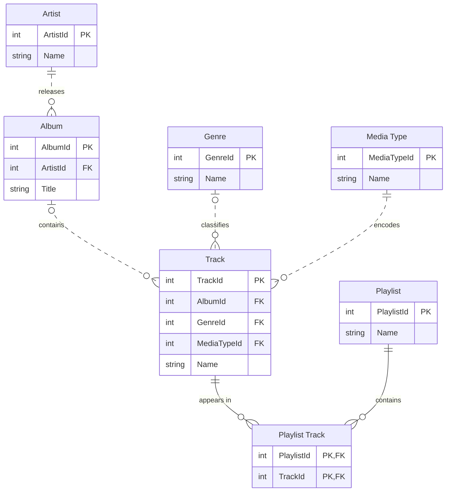
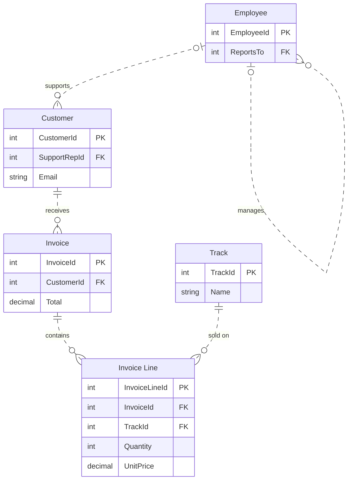

# Chinook · PostgreSQL Practice

A SQL and Python learning exercise built around the Chinook sample music-store database.

**PostgreSQL · Python**

[Getting started](#getting-started) · [Data model](#entity-relationship-diagrams) · [Repository guide](#repository-guide) · [Checks](#checks-and-review) · [Credits](#credits-and-reuse)

## What you can explore

- A PostgreSQL database creation script.
- A psycopg2-based Python query exercise.

> **Project notes:** The SQL file includes database creation and schema-changing statements. Inspect it first and use a disposable learning database; the Python connection settings must match your local instance.

## Entity relationship diagrams

The PostgreSQL script creates the Chinook sample music-store schema. The diagrams split it into catalogue and sales so the keys and cardinalities are easier to read. [SQL table definitions and constraints](Chinook_PostgreSql.sql)

### Music catalogue

Every album has an artist. A track needs a media type and can optionally belong to an album or genre. The playlist join table has a composite primary key, so each track can appear at most once in any playlist.



### Sales and customer support

Each invoice has one customer. Each line belongs to one invoice and identifies one track. Customers can have a support representative, and employees can have a manager.



## Getting started

Requires Git, PostgreSQL, the `psql` client and Python 3. Start by cloning and reading the SQL script:

```bash
git clone https://github.com/SamOBrienOlinger/Chinook-Database-SQL.git
cd Chinook-Database-SQL
```

Inspect [Chinook_PostgreSql.sql](Chinook_PostgreSql.sql) before importing it into a disposable PostgreSQL instance. Review [sql-psyco.py](sql-psyco.py) and replace its connection settings with your own local database details. Its `psycopg2` import requires that adapter to be installed in your Python environment.

Check the available tables and sample rows before experimenting with queries. This repository does not include a dependency lock or an automated test runner.

## Repository guide

| Path | Purpose |
| --- | --- |
| [Chinook_PostgreSql.sql](Chinook_PostgreSql.sql) | Sample database definition |
| [sql-psyco.py](sql-psyco.py) | Python query exercise |

## Checks and review

Use sample queries against a disposable Chinook database and compare the returned rows with the schema. No automated test command is configured.

## Credits and reuse

Learning resources and starter material: [Code Institute](https://codeinstitute.net/).

No repository-level licence file is present in this snapshot. This README does not grant additional reuse permissions. Check with the relevant rights holders before reusing code, written content or assets.

## Support

Repository maintained in [Sam O’Brien-Olinger’s GitHub account](https://github.com/SamOBrienOlinger). For a problem or suggested improvement, [open an issue](https://github.com/SamOBrienOlinger/Chinook-Database-SQL/issues) with the affected page or command, steps to reproduce, and expected behaviour.

[Back to top](#chinook--postgresql-practice)
